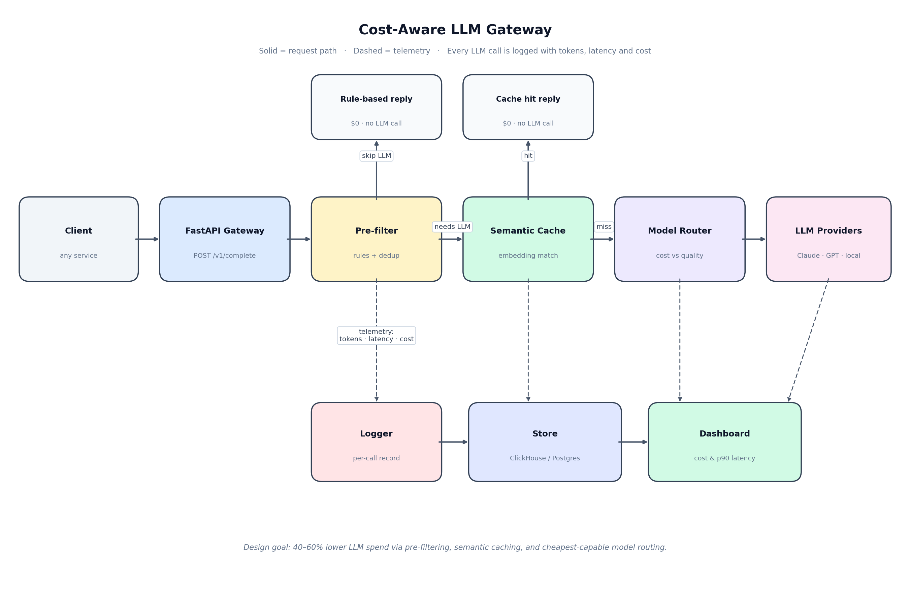
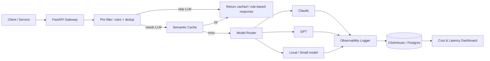
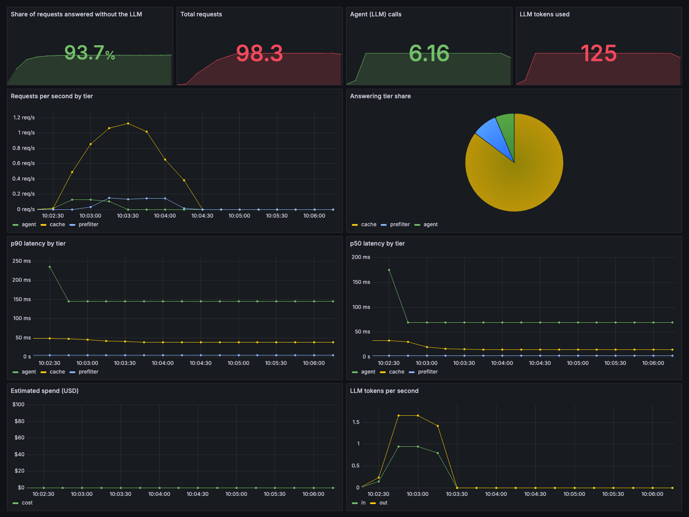

# Cost-Aware LLM Gateway + Observability

A production-style gateway for LLM calls that cuts cost and adds visibility — inspired by real incident-triage systems that reduced LLM cost per incident by 60% via event-triggered invocation and telemetry pre-filtering.

This is Project 1 of 3 for ML Platform / LLM Infra positioning. Built with Python, FastAPI, Docker, and ClickHouse/Postgres for observability.

## Why this exists

Most teams call LLMs on every event. That's expensive and slow. This gateway:
- Only calls the LLM when needed (rule-based pre-filtering + deduplication)
- Routes to the cheapest model that can handle the request
- Caches semantically similar requests
- Logs every call with tokens, latency, and $ cost for analysis

## Architecture





### Request flow
1. Client sends request to `POST /v1/complete`
2. Pre-filter checks: is this a duplicate? Can a rule handle it without LLM?
3. Semantic cache lookup (embeddings similarity)
4. Model router picks cheapest capable model based on task type + SLO
5. Call LLM with retries/fallbacks
6. Log to observability DB: prompt hash, model, tokens in/out, latency p50/p90, cost, cache hit/miss, filter decision
7. Return response + cost metadata in headers

## Quickstart

The gateway uses the open-source `qwen2.5:3b` model through a local Ollama container. No API keys or separate Ollama install are required. Docker Compose downloads the Ollama image and model on first startup; the model is kept in a persistent Docker volume.

Start the gateway, Ollama, Prometheus, and Grafana from the repository root:

```bash
docker compose up --build
```

The first startup downloads the model and can take several minutes. Set `DEFAULT_MODEL` in your shell or `.env` to use another Ollama model. The configured model must be available in the Ollama model library.

In another terminal, send a request. This known runbook error is answered without calling the model:

```bash
curl -X POST http://localhost:8000/v1/complete \
  -H "Content-Type: application/json" \
  -d '{"prompt": "Container api-7f9c8 OOMKilled exit code 137", "task_type": "triage"}'
```

Check service health at http://localhost:8000/health, metrics at http://localhost:8000/metrics, Prometheus at http://localhost:9090, and Grafana at http://localhost:3000. The provisioned Grafana dashboard is named **LLM Gateway**. To stop the stack, press Ctrl+C if Compose is attached, or run `docker compose down` in another terminal.

If Ollama is unavailable, the gateway falls back to a local Hugging Face GPT-2 model on agent requests. Its first use downloads the model and may be slow; Ollama is recommended for the demo.

## Benchmark

The benchmark compares direct calls to the configured Ollama model against the gateway pipeline on a small fixed dataset. It measures p50/p95 latency, gateway tier counts, LLM calls avoided, Ollama-reported token counts for direct calls, gateway token metrics, and a basic expected-keyword check. The runner starts a temporary gateway with an isolated Chroma database; it does not clear or modify the Compose gateway's cache.

With the Compose stack running and the Python dependencies installed locally:

```bash
python -m pip install -r requirements.txt
python benchmarks/run_benchmark.py --model qwen2.5:3b --ollama-url http://localhost:11434 --output benchmarks/results/qwen2.5-3b.json
```

Review the JSON report before making claims. Keyword matching is only a rough screen, not a human quality assessment. Gateway token metrics currently estimate tokens by whitespace word count, while Ollama reports tokenizer counts, so those totals are not directly comparable. Results also depend on local hardware and the model version.

### Recorded run: Qwen 2.5 3B

A local exploratory run used Ollama model `qwen2.5:3b` (Q4_K_M, 3.1B parameters) on November 11, 2026, with the five cases in `benchmarks/cases.jsonl`:

| Measurement | Result |
| --- | ---: |
| Gateway requests | 15 |
| Runbook pre-filter | 6 (40%) |
| Semantic cache | 6 (40%) |
| Debug agent / model | 3 (20%) |
| Requests not sent to model | 12/15 (80%) |
| Gateway end-to-end latency, p50 / p95 | 34 ms / 30.3 s |
| Direct Ollama latency, p50 / p95 (5 original prompts) | 129.9 s / 185.2 s |
| Expected-keyword check | 100% for both paths (weak screening check only) |

The direct baseline ran once per original case (5 requests); the gateway ran each original plus two variants (15 requests), so the latency percentiles are **not an apples-to-apples comparison**. Gateway p95 includes the three real model calls; fast pre-filter and cache hits pull its p50 down. The model returned long direct-baseline answers (3,272 output tokens total according to Ollama). Gateway token counts are word-count estimates and cannot be compared to that tokenizer count. This small synthetic run is evidence that the tiers execute and avoid model calls on this dataset, not a general quality, speedup, or token-savings claim. The direct baseline also answered the OOM case with the model while the gateway answered it from the curated runbook.

## Demo: Grafana dashboard

`docker compose up --build` also starts Prometheus (http://localhost:9090) and Grafana (http://localhost:3000, anonymous viewer). The `LLM Gateway` dashboard is provisioned from `deploy/observability/grafana/dashboards/llm-gateway.json` and shows the share of requests answered without the LLM, requests and p50/p90 latency by tier, and token use.



End-to-end trace of a runbook answer, an unseen error sent to the debug agent, and a related error served from semantic cache: [docs/end-to-end-workflow.png](docs/end-to-end-workflow.png). The values were captured from live local API responses; the image is a formatted trace, not a raw terminal screenshot. The agent endpoint used a canned mock Ollama response.

Captured from a local `docker compose` run with about 100 requests and a stubbed LLM, so agent latency and token counts are not representative. Panel values such as 98.3 are fractional because Prometheus `increase()` extrapolates. Summary page: https://apps.abacus.ai/chatllm/share/artifact/2a6f43251:136764ceb6

## Project structure

```
app/
  main.py              # FastAPI app, /v1/complete endpoint
  gateway/
    router.py          # model routing logic (cost vs quality)
    cache.py           # semantic cache (stub -> plug in pgvector/Qdrant)
    prefilter.py       # rule-based filtering + dedup
  observability/
    logger.py          # logs every LLM call with cost/latency
    metrics.py         # aggregates for dashboard
docs/
  architecture.png     # architecture diagram
docker-compose.yml     # api + postgres/clickhouse
examples/
  k8s_triage_client.py  # K8s log watcher calling the gateway only for suspicious events
  log_triage_client.py  # same pattern for Docker / Spark / Flink logs
```

## K8s triage agent usage

The gateway is designed to sit underneath agents. `examples/k8s_triage_client.py`
shows the intended pattern: a log watcher applies cheap rule-based health
checks first (healthy / known-issue / suspicious) and only calls the gateway
for suspicious events. Run it with the gateway up:

```bash
python examples/k8s_triage_client.py
```

The agent decides *whether* an LLM call is warranted; the gateway decides
*how* to make it cheap.

`examples/log_triage_client.py` applies the same pattern to data-platform
log sources: Docker daemon errors, Spark driver/executor failures, and
Flink JobManager/TaskManager errors. Known issues (OOM, port conflicts,
checkpoint timeouts, missing tables, ...) are answered from runbooks with
no LLM call; only ambiguous failures reach the gateway.

```bash
python examples/log_triage_client.py
```

## Benchmarks to add

Create `benchmarks/` with:
- `cost_comparison.ipynb` or `.py`: cost per 1k requests with vs without pre-filtering + caching
- Track: cache hit rate, % requests filtered (no LLM call), avg cost per request, p90 latency

Goal to demonstrate: 40-60% cost reduction on repetitive workloads — same pattern as production incident triage.

## Roadmap
- [ ] Add pgvector for real semantic cache
- [ ] Add eval harness for router decisions
- [ ] Add Grafana dashboard from observability DB
- [ ] Add load test (k6/locust) numbers to README

## What this proves for hiring

- You think about LLM cost, not just demos
- You can design for reliability (retries, fallbacks, caching)
- You instrument everything (tokens, latency, $)
- You understand production tradeoffs: quality vs cost vs latency
