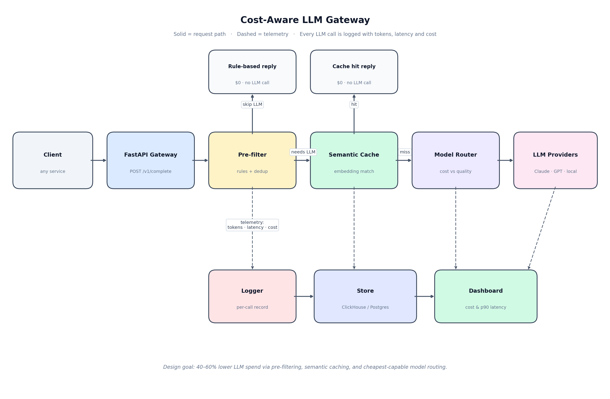
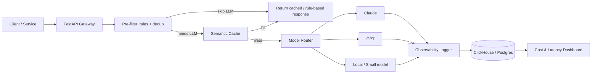

# Cost-Aware LLM Gateway + Observability

A production-style gateway for LLM calls that cuts cost and adds visibility — inspired by real incident-triage systems that reduced LLM cost per incident by 60% via event-triggered invocation and telemetry pre-filtering.

This is Project 1 of 3 for ML Platform / LLM Infra positioning. Built with Python, FastAPI, Docker, and ClickHouse/Postgres for observability.

## Why this exists

Most teams call LLMs on every event. That's expensive and slow. This gateway:
- Only calls the LLM when needed (rule-based pre-filtering + deduplication)
- Routes to the cheapest model that can handle the request
- Caches semantically similar requests
- Logs every call with tokens, latency, and $ cost for analysis

## Architecture





### Request flow
1. Client sends request to `POST /v1/complete`
2. Pre-filter checks: is this a duplicate? Can a rule handle it without LLM?
3. Semantic cache lookup (embeddings similarity)
4. Model router picks cheapest capable model based on task type + SLO
5. Call LLM with retries/fallbacks
6. Log to observability DB: prompt hash, model, tokens in/out, latency p50/p90, cost, cache hit/miss, filter decision
7. Return response + cost metadata in headers

## Quickstart

```bash
cp .env.example .env
# fill in ANTHROPIC_API_KEY, OPENAI_API_KEY
docker compose up --build
```

Test:
```bash
curl -X POST http://localhost:8000/v1/complete \
  -H "Content-Type: application/json" \
  -d '{"prompt": "Summarize this K8s pod error: CrashLoopBackOff", "task_type": "triage", "max_cost_usd": 0.02}'
```

## Project structure

```
app/
  main.py              # FastAPI app, /v1/complete endpoint
  gateway/
    router.py          # model routing logic (cost vs quality)
    cache.py           # semantic cache (stub -> plug in pgvector/Qdrant)
    prefilter.py       # rule-based filtering + dedup
  observability/
    logger.py          # logs every LLM call with cost/latency
    metrics.py         # aggregates for dashboard
docs/
  architecture.png     # architecture diagram
docker-compose.yml     # api + postgres/clickhouse
examples/
  k8s_triage_client.py  # K8s log watcher calling the gateway only for suspicious events
  log_triage_client.py  # same pattern for Docker / Spark / Flink logs
```

## K8s triage agent usage

The gateway is designed to sit underneath agents. `examples/k8s_triage_client.py`
shows the intended pattern: a log watcher applies cheap rule-based health
checks first (healthy / known-issue / suspicious) and only calls the gateway
for suspicious events. Run it with the gateway up:

```bash
python examples/k8s_triage_client.py
```

The agent decides *whether* an LLM call is warranted; the gateway decides
*how* to make it cheap.

`examples/log_triage_client.py` applies the same pattern to data-platform
log sources: Docker daemon errors, Spark driver/executor failures, and
Flink JobManager/TaskManager errors. Known issues (OOM, port conflicts,
checkpoint timeouts, missing tables, ...) are answered from runbooks with
no LLM call; only ambiguous failures reach the gateway.

```bash
python examples/log_triage_client.py
```

## Benchmarks to add

Create `benchmarks/` with:
- `cost_comparison.ipynb` or `.py`: cost per 1k requests with vs without pre-filtering + caching
- Track: cache hit rate, % requests filtered (no LLM call), avg cost per request, p90 latency

Goal to demonstrate: 40-60% cost reduction on repetitive workloads — same pattern as production incident triage.

## Roadmap
- [ ] Add pgvector for real semantic cache
- [ ] Add eval harness for router decisions
- [ ] Add Grafana dashboard from observability DB
- [ ] Add load test (k6/locust) numbers to README

## What this proves for hiring

- You think about LLM cost, not just demos
- You can design for reliability (retries, fallbacks, caching)
- You instrument everything (tokens, latency, $)
- You understand production tradeoffs: quality vs cost vs latency
